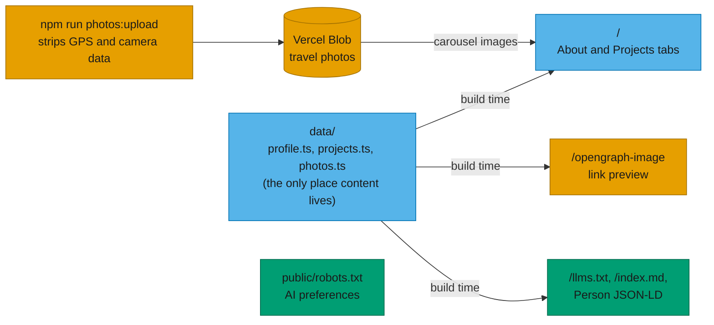

# personal-site

Trista Mueller's personal site: an About tab and a Projects tab.

Built with Next.js 16 and Radix Themes.

```bash
npm install
npm run dev     # http://localhost:3000
npm run build   # production build
npm run lint
npm test        # unit tests (Vitest); npm run test:watch to keep them running
```

CI (`.github/workflows/ci.yml`) runs lint, type-check, tests and build on every push to `main`.

- **Projects** live in `data/projects.ts`. Each project has a name, a description, links and tags.
- **About** text is in `components/Hero.tsx`.
- **Travel photos** live in Vercel Blob and are listed in `data/photos.ts`. The carousel on the About tab only appears once that list has photos. To add one:

  ```bash
  BLOB_READ_WRITE_TOKEN=... npm run photos:upload -- path/to/photo.jpg
  ```

  The script rotates the photo upright, fits it within 2400px and re-encodes it as JPEG. That strips GPS location, camera details and timestamps; it checks they're gone and refuses to upload if not. Then it uploads the photo and prints the entry to paste into `data/photos.ts`, where you fill in the alt text and caption.
- **Light/dark mode** follows the system until you use the toggle in the header, then remembers your choice ([next-themes](https://github.com/pacocoursey/next-themes)). The accent is teal in light mode and violet in dark mode.
- **Icons and link preview:** `app/icon.svg` is the favicon: a "T" drawn with two bars, teal, and violet in dark mode. `app/apple-icon.tsx` and `app/opengraph-image.tsx` generate the iOS home-screen icon and the 1200×630 link-preview image at build time, from `lib/brand.ts` and `data/profile.ts`.
- **Photo:** the header has a placeholder circle. Put the image in `public/` and uncomment the `<Image>` in `app/page.tsx`.

## How it works

All the content lives in `data/`. The page, the files for AI agents and the link-preview image are built from it, so they can't drift apart. Travel photos live in Vercel Blob and only appear once `data/photos.ts` lists some.



## For AI agents

The site describes itself to AI agents as well as to people:

- **`/llms.txt`**: a Markdown index of the site, following [llmstxt.org](https://llmstxt.org/).
- **`/index.md`**: the whole page as clean Markdown. The HTML page links to it with `rel="alternate" type="text/markdown"`, and points to `/llms.txt` with `rel="describedby"`.
- **`/robots.txt`**: says search and live AI answers are welcome but model training isn't. It uses both Cloudflare's [Content Signals](https://contentsignals.org/) (`Content-Signal: search=yes, ai-input=yes, ai-train=no`) and the IETF AI Preferences draft (`Content-Usage: train-ai=n`).
- **schema.org `Person` JSON-LD** on the page.

About and Projects text lives once, in `data/profile.ts` and `data/projects.ts`. The page, the Markdown files and the JSON-LD are all built from those two files, so they can't drift apart. Links are relative until the site has a domain.
